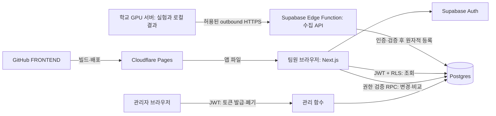

# DXCEL 대시보드 구조 제안

작성일: 2026-11-04 (Asia/Seoul)
상태: 검토용 설계 초안. 개발 도구와 최소 시작 화면을 준비했으며 현재 실행 상태는 README를 따른다. 연구 기능·도메인 DB migration·외부 배포는 후속 구현 범위다.

## 1. 목적과 현재 상태

학교 GPU 서버의 합성 데이터 생성 연구 결과를 수집하고, EXP 단위 연구 의도와 실행별 결과를 보존한다. 수치를 덮어쓰는 비교표 대신 baseline 비교, 설정 차이, 이전 실험과의 연결, 결론 수정 이력을 제공한다.

- 확정: Next.js 사용, DXCEL-FRONTEND / DXCEL-BACKEND 두 저장소 유지, 무료 운영 우선.
- 확정: 학교 서버에는 외부 접속용 웹 서비스를 배포하지 않는다.
- 설계 시작 당시 두 저장소는 README만 있었으며 GitHub TEAM-DXCEL 조직에 연결돼 있다. 이후 초기 개발 환경을 구성했다.
- 서버 조사 보고서 기준: 현재 Docker 컨테이너에서 외부 HTTPS GET/무해한 POST 성공, Python 3.10.12 사용 가능, 기존 감독 스크립트와 완료 파일을 활용한 독립 업로더가 적합하다. 이 내용은 사용자가 전달한 보고서의 확인 사항이며 이 PC에서 서버를 재검증하지 않았다.
- 미확정: 실제 수집 API 목적지에 대한 인증된 POST, 지속 실행·컨테이너 재생성 후 저장 지속성, 학교 외부 저장 정책.
- 제안: 팀원만 연구 자료를 열람하는 비공개 프로젝트를 기본값으로 사용한다. 공개 공유는 별도 기능으로 미룬다.
- 제안: 논문용 지표 이름·단위·방향·평가 버전은 실제 평가 코드에서 확정한다. 아래 예시는 연구의 확정 지표가 아니다.

성공 기준: 과거 결과를 잃지 않고, 어떤 코드·데이터·설정으로 나온 수치인지 찾으며, 동일 조건의 baseline 및 이전 실험과 비교할 수 있다. 수치 변화와 연구자의 원인 해석을 구분한다.

초기 제외: 웹에서 학습 실행, GPU 작업 스케줄링, 원본 데이터·모델 가중치 업로드, epoch별 전체 로그, 공개 리더보드, 상시 WebSocket, 자동 인과 추론.

## 2. 배포 접근법 비교

| 접근법 | 장점 | 제약 | 제안 |
| --- | --- | --- | --- |
| Next.js 정적 export + Cloudflare Pages + Supabase | 상시 앱 서버 불필요, 저장소 역할 분리, 인증·DB·수집 함수 통합 | Next.js 런타임 SSR/Server Actions/API Route 사용 불가 | 초기 기본안 |
| Next.js 전체 기능 + Cloudflare Workers/OpenNext + Supabase | SSR, 런타임 동적 경로, 서버 기능 사용 가능 | 어댑터·Workers 한도와 번들 검증 필요 | 서버 기능 필요 시 확장안 |
| Next.js + Vercel Hobby + Supabase | Next.js 배포 편의 | 조직 저장소 연동과 개인·비상업 사용 제한을 별도 확인해야 함 | 현재 조직 저장소의 기본안에서 제외 |

이 문서는 첫 번째 접근법을 작성자의 추천안으로 구체화한다. 사용자에게 선택·승인받은 것으로 간주하지 않는다. 별도 Node/Nest/FastAPI 상시 서버는 현재 요구에 필요하지 않다. BACKEND 저장소는 Supabase SQL, 함수, API 계약, 서버 업로더를 관리한다.

## 3. 시스템 경계



브라우저에 전달되는 것은 Supabase URL과 publishable key이며, 이것만으로 연구 결과에 접근할 수 없어야 한다. 로그인 JWT와 프로젝트 membership을 DB에서 검사한다. 서버 전용 DB 비밀키와 ingestion token은 프론트 환경변수·번들에 넣지 않는다.

학교 서버가 외부 요청을 보낼 수 없으면 자동 수집 연결은 보류한다. 대시보드·DB 구현은 계속할 수 있고, 동일한 계약의 관리자 파일 등록을 임시 대안으로 둔다. 네트워크 제한 우회는 하지 않는다.

## 4. 도메인과 핵심 동작

- **Experiment:** EXP-023 같은 연구 질문/변경 가설. 담당자, 이전 실험, 설계 revision을 가진다.
- **Experiment revision:** 가설, 변경 이유, 평가 계획을 수정할 때 추가하는 버전. 실행은 정확한 revision에 연결한다.
- **Run group:** 동일한 동결 소스·기본 설정·비교 조건에서 반복한 평가 결과 묶음. 반복은 repeat_key로 식별한다. 하이퍼파라미터·생성량·평가 범위가 다르면 별도 묶음이다.
- **Generation output:** 생성 실행과 합성 출력의 식별 정보·해시. 데이터 행은 업로드하지 않는다. 같은 출력을 다시 평가해도 생성을 다시 수행한 것으로 세지 않는다.
- **Run:** 반복과 평가 attempt별 완료된 평가 기록. 같은 출력의 재평가는 새 run ID로 연결한다. 생성 seed와 DP 난수 seed를 동일시하지 않으며, 난수 상태·DP 잡음 seed는 수집하지 않는다.
- **Comparison context:** 데이터셋/분할/전처리/평가 코드 해시/지표 정의 버전/분류·회귀 과제/전체량 또는 공통 N 평가/평가 표본 수를 고정한 비교 조건.
- **Baseline version:** 내부 실행의 확정 결과 또는 출처가 있는 기존 비교표/논문 보고값을 고정한 비교 기준. 새 baseline은 새 버전으로 만든다. 보고값에는 가짜 실행·seed를 만들지 않는다.
- **Research note:** 결과 해석과 다음 행동. 편집해도 이전 revision을 보존한다.

대표 결과는 사용자가 확정된 group을 선택한다. 단일 최고 수치를 자동으로 대표로 승격하지 않는다. 그룹 확정 시 반복별 포함 run 또는 제외 이유를 명시하고, 이후 멤버·수치·설정을 바꾸지 않는다. 같은 반복의 재평가 중 하나만 통계에 포함하고 나머지 기록은 보존한다. 실패 반복을 제외해도 실제 실행을 복제하지 않으며, 예상 반복 대비 포함 수와 제외 이유를 계속 표시한다.

과거 baseline 비교는 group에 기록된 당시 baseline_version_id로 계산한다. 사용자가 다른 baseline으로 재비교하는 것은 별도 조회이며, 당시 기준을 바꾸지 않는다.

확정 후 일부 반복만 동일 조건으로 재평가하면 이전 group을 부모로 둔 새 group에서 새 평가와 기존 평가 참조를 조합해 새 snapshot을 만든다. 기존 run을 복제하지 않으며, 원본 snapshot은 유지한다. 다른 평가 코드/조건의 결과를 기존 평가와 섞지는 않는다. 화면에서 신규 평가 수와 포함 반복 수를 구분한다.

## 5. 페이지와 사용 흐름

| 경로 | 목적과 주요 기능 |
| --- | --- |
| /login | GitHub OAuth 로그인, 접근권한 없음 안내 |
| /auth/callback | 브라우저에서 OAuth code/PKCE 세션 교환 처리 |
| /overview?project=… | 실험·실행 현황, 최근 변경, baseline별 대표 결과, 동기화 상태 |
| /experiments?project=… | EXP 번호/담당자/태그/상태 검색, 필터·정렬·페이지 이동 |
| /experiments/view?project=…&id=… | 설계 버전, 이전 실험, 실행 묶음, 결론과 수정 이력 |
| /runs?project=… | 개별 실행 검색, 실패·누락·미등록 실행 확인 |
| /runs/view?project=…&id=… | 수치, 전송 허용 설정, 동결 소스·데이터 버전, 생성 출력·재평가 관계 |
| /compare?project=…&groups=…&baseline=… | 동일 조건 비교, 평균/표준편차/n, 반복별 값, 설정 diff, 전체량/공통 N 구분 |
| /baselines?project=… | 이름별 baseline 버전과 선정 이유 |
| /activity?project=… | 실험·노트·대표 결과·권한 변경 기록 |
| /settings?project=… | 프로젝트 구성원, ingestion token, 저장용량·마지막 동기화 |

실험 상세의 제안 섹션: 연구 의도 → 변경 사항 → 결과 → 해석 → 다음 실험. 이는 화면 설계의 제안이며 시각 스타일·배치는 아직 확정하지 않는다.

정적 export에서는 새 실험마다 /experiments/[id]를 빌드할 수 없다. 따라서 초기에는 고정 페이지 + query ID로 조회한다. 서버 전용 cookies(), 런타임 Route Handler, Server Actions, ISR에 의존하지 않는다. useSearchParams 사용 컴포넌트는 필요한 Suspense 경계를 둔다. 인증 화면 숨김은 보안 경계가 아니며 DB RLS가 경계다.

실험이 추가돼도 앱 재배포 없이 즉시 조회 가능해야 한다. 비공개 데이터는 빌드 시 HTML/JSON으로 생성하지 않는다.

## 6. 프론트엔드 기술과 디렉터리 제안

Next.js App Router + TypeScript, Tailwind CSS + shadcn/ui, TanStack Query/Table, ECharts, Supabase browser client를 제안한다. 라이브러리 버전은 구현 시 공식 호환성을 확인하고 lockfile로 고정한다.

```text
DXCEL-FRONTEND/
  docs/
    architecture.md
  src/
    app/
      layout.tsx
      page.tsx
      login/page.tsx
      auth/callback/page.tsx
      (dashboard)/
        layout.tsx
        overview/page.tsx
        experiments/page.tsx
        experiments/view/page.tsx
        runs/page.tsx
        runs/view/page.tsx
        compare/page.tsx
        baselines/page.tsx
        activity/page.tsx
        settings/page.tsx
    components/
      ui/
      layout/
      charts/
    features/
      auth/
      projects/
      experiments/
      runs/
      comparisons/
      baselines/
      notes/
      ingestion/
    lib/
      supabase/
      query/
      format/
    generated/
      database.types.ts
      ingest-v1.types.ts
  next.config.ts
```

위 디렉터리는 목표 구조다. 초기 개발 환경에서는 src/app과 개발 도구만 생성하고 나머지는 기능 구현 시 추가한다.

기능별 디렉터리는 components / queries / mutations / types처럼 필요할 때 분리한다. URL에 필터·정렬·비교 대상을 저장해 팀원이 동일한 화면을 공유할 수 있게 한다. 인증 세션 변경·프로젝트 전환 시 캐시를 분리/삭제하고 로그아웃 시 비공개 Query 캐시를 제거한다. 초기에는 브라우저 영구 데이터 캐시를 사용하지 않는다.

리스트는 50행 단위 cursor pagination, 비교 화면은 최대 6개 group과 20개 선택 지표를 기본 정책으로 한다. 수치 전체를 매번 다운로드하지 않는다. 실시간 구독 대신 조회 시 갱신과 진행 중 화면의 제한적 polling을 사용한다.

## 7. API와 데이터 접근

- 일반 조회: Supabase Data API + RLS. 모든 주요 테이블에 project_id를 포함한다.
- 복합 조회: invoker 권한의 비교 RPC/뷰. 집계·baseline 차이를 서버 DB에서 계산한다.
- 사람의 변경: JWT를 검증하는 transaction RPC. 작성자, revision, audit event를 같은 transaction에 기록한다.
- 수집: POST /functions/v1/ingest-run. 별도 project-scoped token. 회원 JWT와 혼용하지 않는다.
- 토큰 관리: 별도 관리 Edge Function. 사용자 JWT 확인 후 owner만 발급/회수 가능.
- 첨부파일: 초기에는 서버 보관 위치를 나타내는 안전한 논리 참조만 저장. 실제 외부 파일 다운로드 기능은 제외.

RPC 이름과 입력 계약, DB 구조는 BACKEND의 docs/database-design.md에 정의한다. 이 문서의 디렉터리나 API 경로는 구현 계약 초안이며 아직 배포된 기능이 아니다.

## 8. 비교 규칙

1. context_id가 다른 결과는 baseline delta/순위를 계산하지 않는다. 탐색 화면에서 나란히 보여줄 수는 있으나 비교 불가 이유를 표시한다.
2. 지표별 높을수록 좋음/낮을수록 좋음/목표값 근접을 정의한다. 단순히 모든 수치 상승을 개선으로 표시하지 않는다.
3. 기본 통계는 선택된 성공 run의 평균, 표본 표준편차, n과 포함 반복 목록이다. n=1이면 표준편차는 미정이다. 초기 반복 단위는 생성 실행이며, 같은 생성 실행의 복수 출력·재평가를 독립 표본으로 중복 집계하지 않는다. 독립성 가정은 평가 계획에 명시한다.
4. 예상 반복이 누락되면 불완전 결과로 표시한다. 실패는 0으로 바꾸지 않는다.
5. repeat_key나 seed 숫자가 같다는 이유로 paired 분석을 수행하지 않는다. 실제 대응되는 데이터 분할·출력·반복 설계가 검증된 pairing 정보가 있을 때만 제공한다. 초기 기본 비교는 비대응 기술 통계다.
6. 절대 차이를 기본으로 한다. 상대 변화율은 baseline=0이면 미정이며 방향과 단위를 명시한다.
7. 프라이버시 공격 점수와 형식적 DP 보장(epsilon/delta/가정)을 구분한다. 단일 종합 점수로 자동 합산하지 않는다.
8. 원인에 관한 설명은 연구자 해석으로 표시한다. 수치 차이만으로 변경 사항의 인과 효과를 단정하지 않는다.
9. 미확정 group 통계는 임시 결과로 표시한다. 내부 실행을 대표 결과나 baseline으로 선정할 때는 확정된 group만 사용한다. 제외 반복이 있으면 불완전 표시와 선정 이유를 유지한다.
10. 기존 비교표·논문의 baseline은 보고값임을 명시한다. 출처, 평균/표준편차/n의 알려진 범위, 비교 조건을 기록하고 알려지지 않은 값은 null로 둔다. 내부 실행 기반 결과와 출처 유형을 구분한다. 비교 조건이 확인되지 않으면 참고값만 표시하고 delta/순위/paired 통계를 계산하지 않는다.

## 9. 무료 배포와 운영

2026-11-04 공식 문서 확인 기준이며 요금·한도 변경 가능성이 있다.

| 구성 | 초기 무료 구성 | 주요 제한/대응 |
| --- | --- | --- |
| Frontend | Cloudflare Pages, next build의 out 디렉터리, pages.dev 주소 | 정적 요청 무료·무제한. 빌드·파일 한도 별도. 새 실행 수집 때 재빌드하지 않음 |
| DB/Auth | Supabase Free | DB 500MB, 월 egress 5GB, 비활동 1주 후 중지 가능. 모든 데이터가 무제한이라는 뜻은 아님 |
| Ingest/API | Supabase Edge Functions Free | 월 500,000 invocation. 가벼운 검증/등록만 수행 |
| 파일 | 학교 서버 원본 + 선택적 Supabase Storage | Supabase Free 1GB. 모델·학습 로그 전체는 제외 |
| 개발 | Supabase local + 로컬 Next.js | 개발 데이터로 검증. 필요 시 무료 2개 프로젝트 내에서 staging 분리 |

서버 재학습/지표 재계산은 GPU 서버에서 끝낸다. 인증·프로젝트별 권한 때문에 브라우저만으로 처리할 수 없는 변경은 BACKEND 함수로 보낸다.

Free 운영은 현재 quota 안에서 가능하다는 제안이며 영구 0원/무중단 보장은 아니다. DB 용량, egress, 함수 호출 수를 점검하고, 70%에서 용량 추정과 내보내기를 준비한다. 임의 keep-alive로 정책을 우회하지 않는다. 일시 중지/전송 장애 시 업로더가 결과를 로컬에 보관한다.

스칼라 값·설정·연구 노트 중심으로 저장하고 epoch별 원시 기록·이미지·샘플은 기본 수집하지 않는다. run 수만으로 용량을 단정할 수 없으므로 초기 1,000건을 넣은 뒤 테이블/인덱스 실제 크기를 측정해 예산을 잡는다.

프론트 배포는 FRONTEND main 변경 시에만 실행한다. BACKEND는 migration 및 함수 배포를 분리하고 DB 변경은 호환성 유지 → 프론트 전환 → 구버전 제거 순서로 처리한다. 외부 프로젝트 생성·토큰·CI secret 등록·배포는 구현 단계에서 수행한다.

연구 아카이빙을 위해 DB와 파일 백업은 별도로 필요하다. Supabase Free에는 유료 플랜의 일일 관리형 백업을 전제하지 않는다. 접근 가능한 학교 서버 또는 지정 PC에서 사용자 정의 스키마·데이터·노트·권한·감사 이력을 매일 암호화 export하고, 다른 장치에 주간 사본을 둔다. 수집 JSON만으로 노트·baseline·권한을 복구할 수 없음을 명시한다. 인증 계정 복구와 Storage 백업 범위도 복원 절차에 포함한다.

## 10. 구현 순서 제안

1. DB constraints/RLS/회원 bootstrap과 fixture, 수집 v1 계약 확정.
2. 로컬 수집 API 및 중복·충돌·부분 실패·권한 검증.
3. Next.js 로그인, EXP 목록/상세, 실행 목록/상세.
4. group 확정, baseline 버전, 비교 집계와 설정 diff.
5. 설계/노트 revision, 대표 결과 변경과 활동 이력.
6. 학교 서버 결과 exporter/업로더 연결, 무료 배포와 복원 점검.

서버 연동과 독립적으로 1~5를 로컬 fixture로 진행할 수 있다. 이 목록은 단계 제안이며 아직 승인된 구현 계획은 아니다.

## 11. 구현 전 확인할 사항

- 실제 수집 API HTTPS POST, 업로더 지속 실행 방식, 결과·전송 대기열의 저장 지속성.
- EXP별 결과 adapter와 지표별 허용 목록. PR-AUC/WSD/상관 오차/C2ST/MIA 및 회귀 지표는 실제 코드의 의미·집계·버전을 확인한 뒤 등록한다.
- 비공개 팀 전용이라는 기본 가정과 초기 owner/팀원 계정 목록.
- 그룹 기준 및 예상 반복 수. 초기 규칙은 동일 설정+동결 소스+확인된 환경+context에서 반복만 다름. 환경이 알려지지 않은 경우 추정값을 채우지 않고 재현 정보 부족을 표시한다.
- 설계안 검토 후 정적 export 제약을 수용할지, SSR 기능이 반드시 필요한지.

## 12. 서버 조사 반영

별도 업로더가 EXP122/123/124의 명시된 경로만 읽고 completion.json의 passed 상태·결과/출력 해시 연결·필수 평가 단계를 검사한다. 실험 루트 complete.json까지 기다리지 않는다. EXP123 생성량 확대 경로는 원본 경로와 별도 variant로 식별한다.

기존 연구 스크립트·DP 회계·동결 소스는 변경하지 않는다. 업로더가 결과 형식 변환, ID 레지스트리, 등록된 group/context와의 mapping, 전송 대기열을 담당한다. flat_metrics.json 전체 전송은 금지하며 비DP 진단값이 포함될 수 있으므로 승인된 지표만 추출한다. 기존 대표 비교표 갱신도 변경하지 않는다.

서버 상세 연동 기준은 BACKEND의 docs/server-integration.md를 따른다. 최종 API 테스트와 외부 저장 가능 범위 확인 전 과거 실험을 자동 일괄 전송하지 않는다.

## 공식 근거

- [Next.js static export 및 지원 제약](https://nextjs.org/docs/app/guides/static-exports)
- [Cloudflare Pages의 Next.js 정적 배포](https://developers.cloudflare.com/pages/framework-guides/nextjs/deploy-a-static-nextjs-site/)
- [Cloudflare 정적 요청 요금](https://developers.cloudflare.com/pages/functions/pricing/)
- [Cloudflare Pages 한도](https://developers.cloudflare.com/pages/platform/limits/)
- [Supabase 무료 플랜](https://supabase.com/pricing)
- [Supabase 함수 요금](https://supabase.com/docs/guides/functions/pricing)
- [Supabase 함수 실행 한도](https://supabase.com/docs/guides/functions/limits)
- [Supabase RLS](https://supabase.com/docs/guides/database/postgres/row-level-security)
- [Supabase 백업](https://supabase.com/docs/guides/platform/backups)
- [Vercel Git 저장소 연동 제한](https://vercel.com/docs/git)
- [Vercel Hobby 사용 조건](https://vercel.com/docs/limits/fair-use-guidelines)
